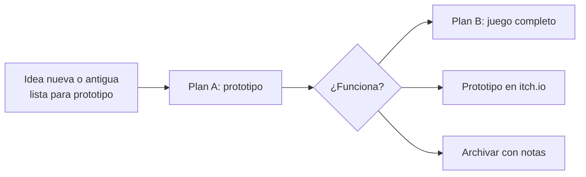

# Plan de desarrollo: juegos completos y prototipos

Cómo se lleva una idea hasta un juego terminado. Empieza donde acaba el flujo de estados de este repo: cuando una idea está **lista para prototipo**, entra en el Plan A. La ficha de seguimiento está en [_plantilla/seguimiento.md](_plantilla/seguimiento.md).

## Cómo usar este plan

Cada idea empieza como prototipo (Plan A). Solo pasa a juego completo (Plan B) si supera la revisión de cierre del prototipo; si no, se archiva con sus notas y no se vuelve a abrir sin motivo.

Solo el prototipo que responde bien a su pregunta pasa al Plan B; los demás se publican tal cual o se archivan.

Reglas que valen para los dos planes:

- Un juego completo activo a la vez, y como mucho un prototipo en paralelo.
- El alcance se escribe antes de empezar y no crece: las ideas nuevas van a la lista «Para otro juego».
- Cada fase termina con algo jugable: commit en git, build y versión jugable (ROM o exportación).
- Cada fase tiene fecha límite. Si se pasa, se recorta alcance, no se amplía el plazo.
- Los prototipos antiguos entran por la fase 0 del Plan A («Rescate») antes de tocar código.
- La ficha de seguimiento se actualiza al cerrar cada fase.

## Plan A: prototipo (1–4 semanas)

Un prototipo responde a una sola pregunta: ¿esta mecánica es divertida y viable en esta plataforma? Está terminado cuando esa pregunta tiene respuesta, no cuando el juego está bonito.

### Fase 0. Rescate (solo prototipos antiguos, 1–2 días)

- [ ] Reunir código, gráficos, notas y builds en una carpeta del repo
- [ ] Comprobar si compila o se abre; si no, anotar qué falta
- [ ] Jugarlo 10 minutos y escribir qué funciona y qué no
- [ ] Escribir en una frase cuál era la idea central
- [ ] Decidir: continuar con el código existente o reimplementar desde cero

### Fase 1. Pregunta y límites (1 día)

- [ ] Mecánica central en una frase
- [ ] La pregunta que debe responder el prototipo
- [ ] Criterio de éxito medible (p. ej. «3 de 4 personas quieren jugar otra partida»)
- [ ] Plataforma y herramienta (GBDK, ASM, Playdate SDK, Godot)
- [ ] Fecha límite del prototipo
- [ ] Lista de lo que NO se hará (menús, música, guardado, niveles extra)

### Fase 2. Núcleo jugable (1–2 semanas)

- [ ] Bucle de juego: entrada, actualización, dibujado
- [ ] Controles con buena respuesta
- [ ] Una pantalla o nivel que permita probar la mecánica
- [ ] Condición de victoria o derrota, aunque sea básica
- [ ] Gráficos provisionales (bloques, sprites simples)
- [ ] Build jugable publicada para probar

### Fase 3. Prueba (2–3 días)

- [ ] Jugarlo uno mismo al día siguiente, con ojos frescos
- [ ] Que lo prueben 2–3 personas sin explicarles nada
- [ ] Anotar dónde se atascan, qué repiten y cuándo lo dejan
- [ ] Ajustar una o dos cosas y volver a probar

### Fase 4. Cierre (1 día)

- [ ] Responder la pregunta de la fase 1 con lo observado
- [ ] Elegir destino: pasar al Plan B, publicar como prototipo en itch.io o archivar
- [ ] Escribir notas: qué funcionó, qué no y qué haría distinto
- [ ] Etiquetar la versión en git (p. ej. `proto-v1`)

**Prototipo terminado =** pregunta respondida, build guardada, notas escritas y destino decidido.

## Plan B: juego completo

Un juego completo está terminado cuando alguien que no lo conoce puede descargarlo, jugarlo de principio a fin y ver los créditos. Menús, pulido y publicación suelen ocupar tanto tiempo como el núcleo del juego, así que se planifican desde el principio.

### Fase 1. Preproducción (1–2 semanas)

- [ ] Documento de diseño de una página: mecánica, objetivo, controles, estilo
- [ ] Lista cerrada de contenido: número de niveles, enemigos, objetos, pantallas y canciones
- [ ] Límites técnicos (en Game Boy: tamaño de ROM, tiles, sprites por línea, bancos)
- [ ] Calendario con fecha por fase y fecha de lanzamiento
- [ ] Lista «Para otro juego» creada (y vacía)

### Fase 2. Corte vertical (2–4 semanas)

- [ ] Un nivel con calidad final: gráficos, sonido, efectos y sensación de control
- [ ] Flujo de trabajo probado: de editar un gráfico o nivel a tenerlo en la build
- [ ] Revisar el calendario con el tiempo real que ha costado este nivel

### Fase 3. Producción (según la lista de contenido)

- [ ] Todo el contenido de la lista, en tandas semanales
- [ ] Build jugable al final de cada semana
- [ ] Congelar funciones: a partir de aquí no entra ninguna mecánica nueva

### Fase 4. Alfa: completo de principio a fin

- [ ] Pantalla de título, menú, pausa y opciones
- [ ] Tutorial o primera pantalla que enseñe a jugar
- [ ] Game over, victoria final y créditos
- [ ] Guardado o contraseñas, si el juego lo necesita
- [ ] Música y efectos en todas las pantallas

### Fase 5. Beta y pulido (1–3 semanas)

- [ ] Solo corrección de errores, equilibrio y pulido
- [ ] Pruebas con 3–5 personas que no hayan visto el juego
- [ ] Probar en emulador preciso y, si es posible, en hardware real o en el dispositivo de destino
- [ ] Lista de errores vacía o con solo errores menores aceptados

### Fase 6. Lanzamiento

- [ ] Build final etiquetada en git (`v1.0`)
- [ ] Página de itch.io: descripción, controles, 3–5 capturas, un GIF y versión jugable en el navegador si se puede
- [ ] Anuncio en las redes o comunidades que uses

### Fase 7. Postlanzamiento (2 semanas)

- [ ] Corregir los errores que se reporten (`v1.0.x`)
- [ ] Escribir un postmortem breve: qué salió bien, qué mal y cuánto tardó cada fase frente a lo previsto

**Juego terminado =** publicado en itch.io o Steam, jugable de principio a fin, etiquetado en git y con postmortem escrito.

## Plan B (opcional): marketing y Steam

Las dos líneas son opcionales e independientes: se puede hacer marketing sin Steam, o publicar en Steam con poco marketing. Si se eligen, se marcan en la preproducción y van en paralelo a las fases del Plan B, no al final. En Steam, la visibilidad del lanzamiento depende sobre todo de las listas de deseos acumuladas antes, así que la página «Próximamente» se abre lo antes posible.

Requisitos de Steam a 24 de noviembre de 2026 ([Steam Direct](https://partner.steamgames.com/steamdirect), [tasa](https://partner.steamgames.com/doc/gettingstarted/appfee), [alta](https://partner.steamgames.com/doc/gettingstarted/onboarding)):

- 100 USD por juego, que se recuperan cuando el juego supera 1.000 USD de ingresos brutos ajustados.
- En tus primeros juegos, 30 días de espera entre el pago de la tasa y el lanzamiento.
- La página «Próximamente» debe ser pública al menos dos semanas antes del lanzamiento.
- Valve revisa la página y la build por separado, en 1–5 días cada una; conviene dejar una semana de margen.
- Steam es solo para juegos de Godot. Los de Game Boy se publican únicamente en itch.io, y los de Playdate en itch.io y, si Panic los acepta, en Catalog.

### Durante la preproducción

- [ ] Decidir si este juego lleva marketing y, si es de Godot, si va a Steam; en itch.io, si será gratis, de pago o «paga lo que quieras»
- [ ] Público y 3–5 juegos parecidos como referencia
- [ ] Nombre definitivo y gancho en una frase
- [ ] Presupuesto: tasa de Steam, arte de cápsula y, si hace falta, tráiler

### Durante el corte vertical

- [ ] Primeros GIF y capturas del nivel de calidad final
- [ ] Devlog o hilo en redes con una entrada cada 1–2 semanas
- [ ] Página de itch.io «en desarrollo»

### Durante la producción

- [ ] Alta en Steamworks: identidad, banco, impuestos y pago de la tasa
- [ ] Arte de cápsula, capturas, descripción y etiquetas de la página de Steam
- [ ] Página «Próximamente» publicada, meses antes del lanzamiento si es posible
- [ ] Tráiler de 30–60 segundos que enseñe la mecánica en los primeros 5 segundos

### Durante la alfa y la beta

- [ ] Demo jugable (y valorar presentarla a un Steam Next Fest)
- [ ] Kit de prensa: descripción, capturas, logotipo, tráiler y contacto
- [ ] Lista de creadores de contenido y medios que cubren juegos parecidos
- [ ] Build de Steam subida y probada en la plataforma

### Lanzamiento y después

- [ ] Fecha fijada con la espera de 30 días y las revisiones de Valve ya cumplidas
- [ ] Claves para prensa y creadores 1–2 semanas antes
- [ ] Anuncio el día del lanzamiento en Steam, itch.io y redes
- [ ] Responder reseñas y publicar al menos una actualización en el primer mes
- [ ] Añadir al postmortem las cifras de listas de deseos y ventas

## Notas por plataforma

| Paso | Game Boy | Playdate | Godot |
| --- | --- | --- | --- |
| Dónde se trabaja | Repo [`Manzupas/gameboy`](https://github.com/Manzupas/gameboy) en git; Claude compila y republica el artefacto jugable desde la nube | Repo en git; SDK oficial (Lua o C) con su Simulador, o Pulp en el navegador para juegos sencillos | En tu PC, con el proyecto en git |
| Límites que hay que fijar en preproducción | Tamaño de ROM y bancos, tiles de fondo, 40 sprites (10 por línea), 4 tonos, canales de sonido | Pantalla de 400×240 en blanco y negro (1 bit), si se usa la manivela, rendimiento en el dispositivo | Resolución, plataforma de exportación (web, escritorio), mandos |
| Build jugable de cada fase | ROM `.gb` + versión web en el artefacto | `.pdx` comprimido en `.zip` | Exportación HTML5 o ejecutable |
| Prueba final | Emulador preciso (SameBoy, Emulicious) y cartucho flash si hay | Simulador y una Playdate real | Exportación final en cada plataforma de destino |
| Publicación | Solo itch.io: ROM descargable + jugable en el navegador con un emulador web; gratis o, en algunos juegos, de pago | itch.io (gratis o de pago; se instala por *sideload* desde play.date) y, opcionalmente, Catalog, la tienda de Panic, que selecciona los juegos | itch.io (HTML5 jugable en el navegador + descargas) y, opcionalmente, Steam |

Cada juego, en el repo de su plataforma, tiene su carpeta con su `README`, su ficha de seguimiento y sus notas de cierre.

## Referencias por fase

| Fase | Referencia | Para qué |
| --- | --- | --- |
| Rescate y cierre | «Finishing a Game», de Derek Yu (ensayo) | Terminar proyectos en lugar de abandonarlos |
| Pregunta y preproducción | *The Art of Game Design*, de Jesse Schell | Definir la mecánica y revisar el diseño con sus lentes |
| Núcleo y producción | [Game Programming Patterns](https://gameprogrammingpatterns.com) | Bucle de juego, estados, eventos |
| Núcleo (Game Boy) | [Pan Docs](https://gbdev.io/pandocs/), [GB ASM Tutorial](https://gbdev.io/gb-asm-tutorial/), [GBDK-2020](https://github.com/gbdk-2020/gbdk-2020) | Hardware, ensamblador y C |
| Núcleo (Playdate) | Inside Playdate (documentación del SDK, en sdk.play.date) | API en Lua y C, Simulador y empaquetado del `.pdx` |
| Núcleo (Godot) | [Documentación de Godot](https://docs.godotengine.org) | Tutorial «Your first 2D game» y exportación |
| Práctica de terminar juegos | 20 Games Challenge | Serie de juegos pequeños de dificultad creciente |
| Lanzamiento y postmortem | [GDC Vault](https://gdcvault.com), *Spelunky* de Derek Yu (Boss Fight Books) | Cómo otros llevaron un juego hasta el final |
